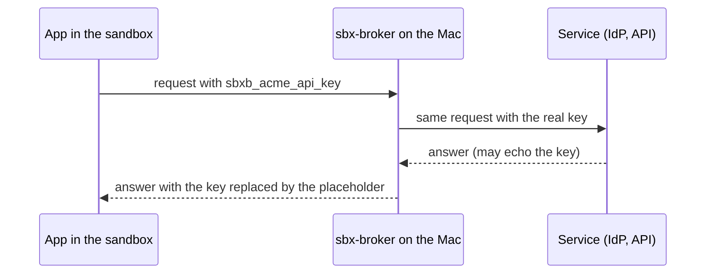

# sbx-broker

Keep real credentials out of your Docker Sandboxes (`sbx`).

An AI agent in a sandbox often has to run an app that calls real services: an identity provider, an API in a dev
cluster, a database. Those calls need client secrets, API keys and passwords, but the agent must never see or hold a
long-lived credential.

`sbx-broker` runs on your Mac and solves this. The app in the sandbox holds a **placeholder** such as
`sbxb_acme_api_key` in place of each secret. It calls the service through the broker, and the broker swaps the
placeholder for the real value on the way out and takes the value out of what comes back. The sandbox only ever sees
placeholders.

## Why not the secrets built into sbx?

sbx has its own credential swap. A kit or a project file declares a secret, the VM sees a placeholder, and the sbx
proxy puts the real value into one request header on the hosts you name. For a token in a header, such as a forge
token or a plain API key header, that is enough, and you should use it.

Many real calls put the credential somewhere else, and there the built-in swap does not help:

| Where the credential goes | sbx built-in swap | sbx-broker |
|---|---|---|
| A header, as plain text (`X-API-Key: <key>`, `Bearer <token>`) | yes | yes |
| A header in Base64 (`Authorization: Basic <base64 of user:secret>`, a Base64 API key) | no: it swaps only the literal text | yes |
| A form or JSON body, such as the `client_secret` of an OAuth token request | no: it swaps only in headers | yes |
| The path or the query of the URL | no: it swaps only in headers | yes |
| A Postgres login | no: the login is not HTTP | yes: the placeholder is the password, the broker logs in with the real one |
| An answer that echoes the secret, such as an IdP error page that quotes the rejected client secret | no: the real value reaches the sandbox | yes for HTTP answers: the broker scrubs it |

The last row matters even for header tokens. The sbx proxy does not scrub answers. An upstream that echoes a request
header or body sends the real value straight into the sandbox. The broker scrubs every HTTP answer, in
[many encoded forms](docs/how-it-works.md#the-forms-the-scrub-covers). For Postgres it swaps the login and scrubs the
error of a failed login only; it does not read queries or results after the login.

Often you cannot move the credential to a plain header. An app may have no setting for it, and the OAuth method
(`client_secret_post`) or the API may not allow it. The broker needs no change to the app beyond its base URL.

The broker also adds what a project with many services needs:

- **One namespace per project.** The port decides the namespace, so one project's sandbox cannot use another
  project's secrets.
- **A log of every use:** each swap and refusal, with the secret names.
- **Clear refusals:** a missing or failed secret gives a JSON 503 that names the secret, and the request does not
  reach the upstream.

These facts about sbx come from probes with sbx v0.53 (see
[Facts this design builds on](docs/specs/2026-11-22-sbx-broker-design.md#facts-this-design-builds-on) in the design).

## How it works



- **Your secrets stay where they are.** The broker gets each value by running a command you already use, such as
  `gopass show -o ...`, `security find-generic-password -w ...` or `op read ...`. It keeps the value in memory only:
  never on disk, never in a log.
- **One namespace per project.** Each namespace has its own secrets and its own routes. A route is a local port that
  forwards to one service. The port decides the namespace, so one project's sandbox cannot use another project's
  secrets.
- **The app barely changes.** It gets a different base URL (`http://host.docker.internal:<port>`) and placeholders in
  place of its secrets. The broker swaps placeholders in headers (also inside Base64 tokens such as
  `Authorization: Basic`), in the path and query, and in form, JSON and text bodies.
- **You see every use.** The broker logs each swap and each refusal, with secret names only.

## Status

| Part | State |
|---|---|
| HTTP routes, swap and scrub | ready |
| The CLI (`serve`, `status`, `refresh`, `reload`, `log`) | ready |
| A Postgres proxy (placeholder as the database password) | ready |
| A TUI to manage secrets and watch the log, and a launchd agent | coming |

It is made and tested for macOS.

## Use it in a project

You need macOS, Go 1.27, Docker Sandboxes, and a command-line tool for your secrets.

### 1. Build and start the broker

```sh
go install ./cmd/sbx-broker      # from a clone of this repo; or: go build ./cmd/sbx-broker
sbx-broker serve
```

Keep `serve` running, for example in its own terminal tab. A launchd agent that starts it at login is coming.

### 2. Describe the project's secrets and services

In the project's root folder, create the project's namespace and open its file:

```sh
sbx-broker init acme      # writes .sbx-broker and ~/.config/sbx-broker/namespaces/acme.yaml
sbx-broker edit           # opens acme.yaml in $VISUAL or $EDITOR
```

The namespace file stays on your Mac, out of reach of the sandbox, because the broker runs the commands in it. The
project folder gets only the marker `.sbx-broker`, which holds the name `acme`. The marker shows that the project
uses the broker, and in the project `status`, `log`, `refresh` and `edit` need no namespace name. The marker holds no
secret, so you may commit it.

The namespace file holds the commands that print the secrets and the services to reach, never a value:

```yaml
secrets:
  client-secret:
    command: ["gopass", "show", "-o", "acme/idp/client-secret"]
  api-key:
    command: ["op", "read", "op://<vault>/<item>/credential"]

http:
  - name: idp
    listen: 29610                     # the broker's port for this route
    upstream: https://<idp-host>      # where the route forwards to
  - name: api
    listen: 29611
    upstream: http://127.0.0.1:9080   # for example a kubectl port-forward on the Mac
```

The broker picks up the file within about 2 s. Check it:

```sh
sbx-broker status
```

`status` shows the marker, the namespace file, and each secret's state and its placeholder: `sbxb_<namespace>_<secret name>`, with each `-` as `_`. Here
`sbxb_acme_client_secret` and `sbxb_acme_api_key`. All rules for the file are in
[docs/configuration.md](docs/configuration.md).

### 3. Open the ports in the project kit

A sandbox reaches a port on your Mac at `http://host.docker.internal:<port>` only through a network rule. The broker
ships no kit: add one rule per route to your project's own kit (schema 3), beside its other rules:

```yaml
capabilities:
  - type: com.docker.sandbox/network-policy@2
    config:
      runtime:
        allow:
          - hosts: ["localhost:29610", "localhost:29611", "localhost:29620"]   # the routes and the Postgres port of namespace acme
```

The Postgres listener of a namespace has its own port (`postgres.listen`, here 29620), and it needs a rule like a route
does. Open only the ports of the project's own namespace. When you change a port in the namespace file, change the kit
too.

### 4. Give the app placeholders

Point the app at the broker's routes, and put the placeholders where it would hold the secrets. A placeholder is not
a secret, so it can live in the project's env files or the sbx project file:

```sh
IDP_URL=http://host.docker.internal:29610
IDP_CLIENT_SECRET=sbxb_acme_client_secret
API_BASE_URL=http://host.docker.internal:29611
API_KEY=sbxb_acme_api_key
```

A route forwards every method and path as they come, so only the base URL changes.

For a database, the placeholder is the password, and the database name is the alias of the entry in the `postgres`
section of the namespace file. The sandbox reaches the broker's Postgres port with no TLS, because the hop stays on
your Mac:

```sh
DATABASE_URL=postgres://<user>:sbxb_acme_app_db_password@host.docker.internal:29620/<alias>?sslmode=disable
```

### 5. Watch it work

```sh
sbx-broker log -f
```

Each call of the app shows as a `swap` event with the names of the secrets it used. A Postgres login shows as a `swap`
event with `<user>@<alias>` in the route column, and `close` when its connection ends.

## Day to day

In a project folder, the marker supplies the namespace. Elsewhere, add it (`sbx-broker status acme`), or leave it out
of `status` and `log` to see all namespaces.

| Task | Command |
|---|---|
| See the secrets and listeners | `sbx-broker status` |
| Change the secrets or routes | `sbx-broker edit` |
| Fetch the secrets again, for example after a rotation or an unlock | `sbx-broker refresh` |
| Fetch one secret again | `sbx-broker refresh acme client-secret` |
| Apply a changed namespace file at once | `sbx-broker reload` |
| Follow the log | `sbx-broker log -f` |

All commands are in [docs/cli.md](docs/cli.md).

## When a request fails

| The app gets | Meaning |
|---|---|
| 503 with `"secret not loaded"` | The secret is still fetching, its fetch failed, or it is not defined. Check `sbx-broker status`. |
| 403 with `"placeholder of another namespace"` | The app used a placeholder of another project. |
| 502 with a JSON body | The service is unreachable, or it answered in a way the broker cannot scrub. |
| 403 with `Approval required for ...` | The sbx proxy blocked the port: the project kit has no rule for it. |
| A Postgres `FATAL` with a code such as `28P01` or `57P03` | The broker refused the login. The codes are in [docs/troubleshooting.md](docs/troubleshooting.md#postgres-logins). |

Details and fixes are in [docs/troubleshooting.md](docs/troubleshooting.md).

## Limits

The broker protects the values, not what an app may do with them: a sandbox can use every secret of its namespace
against the services of that namespace. The hop from the sandbox to the broker is plain HTTP (or a plain Postgres connection) on your Mac. Postgres queries
and results after the login are not scanned: a result that holds a value reaches the sandbox as is. An upstream
that changes a value before it echoes it (for example hashes it) defeats the scrub. WebSockets are not supported. The
full list is in [docs/security.md](docs/security.md).

## Documentation

| Document | What it covers |
|---|---|
| [docs/configuration.md](docs/configuration.md) | Namespace files, names, fetch commands, placeholders, environment variables, reloads |
| [docs/cli.md](docs/cli.md) | Every command, the admin socket, `status`, the log and its event kinds |
| [docs/how-it-works.md](docs/how-it-works.md) | Where the broker swaps, which headers it changes, what the scrub covers, the request limits |
| [docs/troubleshooting.md](docs/troubleshooting.md) | Every answer of the broker, the sbx proxy's 403, common checks |
| [docs/security.md](docs/security.md) | What the broker protects, what it does not do, the known gaps |
| [docs/testing.md](docs/testing.md) | The unit, integration and end-to-end proofs, and how to run them |
| [docs/specs/2026-11-22-sbx-broker-design.md](docs/specs/2026-11-22-sbx-broker-design.md) | The design |

## License

MIT, see [LICENSE](LICENSE).
