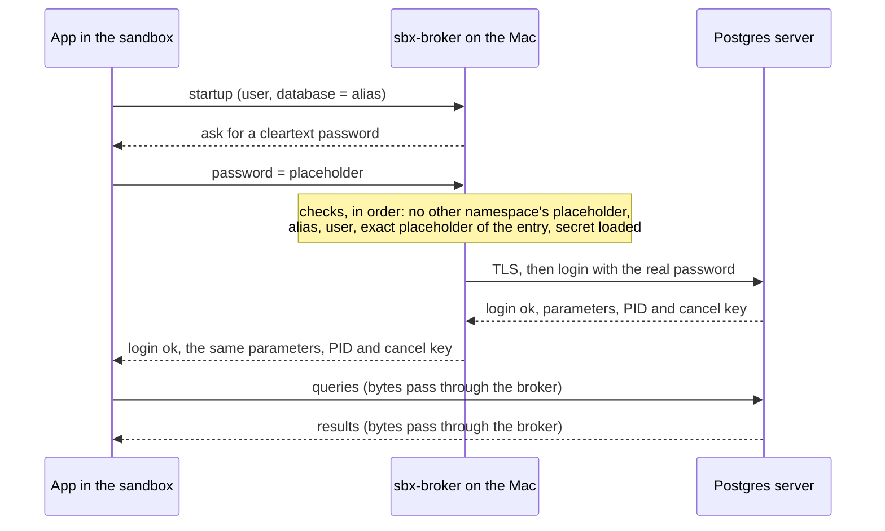

# How the broker handles a request

Each HTTP route is one reverse proxy on `127.0.0.1:<listen>` to one fixed upstream. A route forwards every method and
path as they come, with no path prefix. The listener port decides the namespace: a request may use only the secrets
of that namespace.

## The request: the swap

The broker swaps each placeholder of the namespace for the real value:

- in header values, as text and inside a Base64 token (such as `Authorization: Basic <base64 of user:placeholder>` or
  a Base64 `X-API-Key`);
- in the path and in the query;
- in a form, JSON or `text/*` body.

Each place gets the value in its own encoding (path escape, query escape, the JSON string escape, or as is).

Before it changes anything, the broker checks every placeholder in the request. If one of them cannot be used, it
refuses the whole request and forwards nothing (see [troubleshooting.md](troubleshooting.md)).

### Headers the broker changes

- It sets `Host` to the upstream's host and adds no header that names it.
- It removes the app's `Accept-Encoding`, because the scrub needs the plain bytes of the answer.
- It removes the app's `Range` and `If-Range`: with ranges an app could read a value an upstream stored in pieces
  that the scrub does not recognize, so the upstream always sends the whole answer.

### Request limits

The broker scans a body only when it is `application/x-www-form-urlencoded`, `application/json` or `text/*`, at most
1 MiB, and not compressed (no `Content-Encoding`, or `identity`). Any other body is forwarded unscanned and logged as
`unscanned`; a placeholder in it reaches the upstream as is.

## The answer: the scrub

The broker takes each value of the namespace out of every answer: the header values, the body and the trailers, for
every content type. Header names are not scrubbed.

- **Streaming:** the scrub works on the stream. An event of a server-sent event stream reaches the app at once, and
  a value split across two writes is still caught.
- **Compression:** an upstream that compresses anyway with `gzip` or `deflate` is decoded and scrubbed, and the app
  gets the plain answer with no `Content-Encoding`. Any other encoding gets a 502.
- **Informational answers (1xx)** never pass through the scrub, so the broker drops every one except
  `100 Continue`, which it forwards with no headers.
- **Protocol upgrades** (WebSockets and others) get a 502: the raw stream would pass every scrub.

### The forms the scrub covers

Each form is replaced by the same form of its placeholder:

- the raw value;
- Base64, standard and URL-safe, of the whole value, and embedded in a longer Base64 text (such as an echoed
  `Authorization: Basic` header); in an embedded value up to 4 bits at each edge stay unscrubbed;
- `url.QueryEscape` and `url.PathEscape`;
- the JSON string escape, without and with HTML escaping (`&`, `<`, `>`), and with `/` as `\/`;
- the `encodeURIComponent` form;
- the lowercase-hex versions of the percent-encoded forms (`%2f` for `%2F`);
- the HTML entity forms, as an HTML error page quotes a value: `&`, `<`, `>` as `&amp;`, `&lt;`, `&gt;`, and `"` and
  `'` each as is or as `&#34;` / `&quot;` and `&#39;` / `&#x27;` / `&#039;`.

Other re-encodings are **not** covered: a hash, a split value, another Base64 alphabet, the plain hex of a value,
double encoding, or any other transformation an upstream makes before it echoes a value.

### The values the scrub knows

- the current `ok` values of the namespace;
- the values that went into this request;
- every value the namespace held since the broker started but no longer serves: one that a `refresh` changed or
  dropped (a failed fetch), one that a reload of the namespace file replaced, and the last value of a secret removed
  from the file. An upstream may have stored such a value. The broker keeps these retired values until the namespace
  file is removed or the broker stops.

## Postgres

A namespace with a `postgres` section has one more listener on `127.0.0.1:<postgres.listen>`. The app's URL names it,
the alias of a database entry and the placeholder as the password, with no TLS on the hop from the sandbox:

```text
postgres://<user>:sbxb_acme_app_db_password@host.docker.internal:29620/<alias>?sslmode=disable
```

### The login



- The broker answers an `SSLRequest` or a `GSSENCRequest` of the app with `N`, so the app stays on the plain hop.
- It speaks protocol 3.0 on both sides. A newer client is negotiated down to 3.0.
- A refused login ends with a `FATAL` error and no connection to the real server. The codes are in
  [troubleshooting.md](troubleshooting.md#postgres-logins).
- The startup parameters of the app (such as `application_name` and `options`) go to the real server.

### The hand-off

After the real server accepts the login, the broker sends the app the login confirmation, the server's parameters, the
server's process ID and cancel key, and the ready signal. From then on the two connections copy bytes both ways until
one side closes; the broker then closes the other. A byte the app sends right after its password (a pipelined query)
reaches the real server.

### No scan after the login

The broker swaps and scrubs only the login. It does not read the queries or the results afterwards, so a value that an
answer echoes is not scrubbed (see [security.md](security.md#postgres)). The real server's error at login is scrubbed:
each value of the namespace in it is replaced by its placeholder.

### Cancel requests

A client cancels a query on a new connection that sends the process ID and cancel key it got at login. The broker
matches them against the open sessions of its listener. On a match, it sends the same request to that session's
real server over plain TCP. With no match, it sends nothing. Either way it closes the connection with no answer.

The full design is in [specs/2026-11-22-sbx-broker-design.md](specs/2026-11-22-sbx-broker-design.md).
